 <div align="center">

# 🌙 LumaNav

### Lunar Landing Site Navigator

**See the terrain. Predict the windows. Plan the landing.**

*Discover potential lunar landing sites through terrain-aware visibility analysis and mission simulation.*

[](https://lumanav-eta.vercel.app)

**NASA Space Apps Challenge 2026**

Built by **[Team Flashover](#-team)** for the **Lunar Landing Site Navigator** challenge.

</div>

---

## 🌕 About LumaNav

LumaNav is an interactive lunar landing site exploration and mission-planning platform that brings together **lunar terrain elevation and astronomical positioning data** to help users understand where and when landing conditions may be favorable on the Moon.

A suitable landing location is not determined by its coordinates alone. The surrounding terrain can obstruct sunlight and block a direct line of sight to Earth, affecting solar power availability and communication opportunities. These conditions also change over time as the Sun and Earth move across the lunar sky.

LumaNav addresses this challenge by analyzing the relationship between local lunar topography and astronomical visibility across different locations and landing times.

Users can select a launch location, target landing date, and flight route. The platform then calculates a suitable launch time, evaluates candidate landing sites, and provides the top three recommendations based on sunlight availability and Earth visibility.

From exploring 3D lunar terrain to examining landing windows and watching an Earth-to-Moon flight simulation, LumaNav makes complex environmental conditions easier to explore and understand.

**Explore the Moon. Understand the conditions. Make better-informed landing decisions.**

## 🎬 Demo Video

[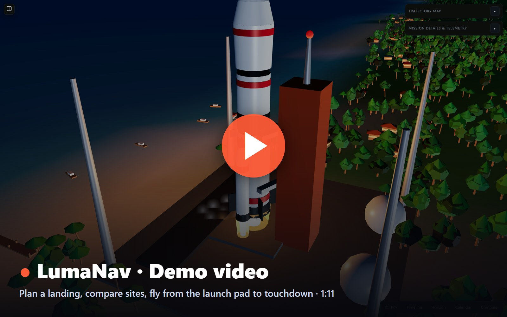](docs/demo.mp4)

About one minute, recorded from the app itself: plan a landing, compare the top three sites, inspect the 30-day window, then fly the mission from the launch pad to touchdown. Click the image to play it.

**Project slides:** [view on Canva](https://www.canva.com/design/DAHa3xY1sBI/kGBhdBmWFyjtK9PsEXorRQ/view)

---

## 🌑 Why Lunar Visibility Matters

The surrounding lunar terrain plays an important role in determining what a landing site can observe and receive.

### ☀️ Sunlight Availability

At the lunar south pole, sunlight often arrives at a low angle. Nearby ridges and crater walls can obstruct sunlight, leaving certain locations in darkness for extended periods.

Understanding local illumination is important when evaluating potential solar power availability for surface operations.

### 🌍 Earth Visibility

A direct view of Earth creates opportunities for communication between a lunar landing site and Earth-based infrastructure.

However, elevated terrain and crater walls can obstruct the line of sight, even when Earth is geometrically positioned above the lunar horizon.

### 📍 Location and Timing

Nearby landing locations can experience different visibility conditions because of their surrounding topography.

Even at the same location, sunlight and Earth visibility change over time as celestial bodies move across the lunar sky.

### 🔭 The Missing Picture

Lunar elevation datasets and astronomical positioning data are available, but understanding how they interact at a specific location and time requires combining both into a unified analysis.

**LumaNav brings these elements together**, allowing users to examine potential landing environments through terrain-aware visibility calculations rather than geographical coordinates alone.

---

## 🚀 Core Features

LumaNav combines lunar environmental analysis, landing-site recommendations, and mission simulation into one interactive platform.

### 1. 📍 Landing Site Recommendations

Evaluate 15 candidate lunar landing locations across the south pole, north pole, near side, and far side of the Moon.

- Top-three landing site recommendations for the selected mission scenario.
- Ranking based on sunlight availability and direct Earth visibility.
- Transparent scoring with individual condition breakdowns.
- Evaluation across the first seven days of surface operations.
- Interactive recommendation previews using 3D lunar terrain.

### 2. ☀️ Visibility Analysis Tools

Examine how astronomical conditions affect a potential landing location.

- Sun position and illumination status.
- Earth's position and direct line-of-sight visibility.
- Daylight and nighttime duration.
- 30-day visibility timeline.
- Yearly calendar of potentially favorable landing days.
- Comparison of landing locations and associated launch delays.

### 3. 🗺️ Horizon & Terrain Profiling

Understand how the surrounding lunar landscape influences visibility.

- 360° lunar horizon profile.
- Terrain elevation analysis across 720 directions.
- Terrain obstruction analysis extending up to 150 km.
- Sun and Earth paths against the local terrain horizon.
- Lunar illumination map.
- Interactive 3D terrain visualization using NASA LOLA elevation data.

### 4. 🛰️ Mission Planner

Explore different mission scenarios and identify suitable launch timing.

- Six selectable launch pads.
- Configurable landing date and time in UTC.
- Three lunar transfer route options.
- Backward calculation of launch time from the target landing moment.
- Comparison of candidate sites and launch delays.
- Landing suitability analysis across different dates.

### 5. 🌌 3D Lunar Mission Simulation

Experience the journey from Earth to the Moon through an interactive flight simulation.

- Real-scale Earth-to-Moon flight visualization.
- Launch and ascent from the selected launch pad.
- Booster separation and orbital transfer.
- Lunar orbit insertion at approximately 100 km altitude.
- Descent and touchdown at the selected landing coordinates.
- Seven-day lunar surface timelapse showing sunlight and Earth visibility conditions.

---

## 🎮 LumaNav in Action

The platform follows a scenario-based workflow that connects mission configuration, landing-site evaluation, and environmental analysis.

<div align="center">

**Mission Planning Workflow**

</div>

1. **Select a Launch Location**

   Choose one of six available launch pads as the starting point of the mission.

2. **Configure the Landing Scenario**

   Set the desired landing date and time in UTC.

3. **Choose a Flight Route**

   Select one of the available transfer options: Fast, Standard, or Low-energy.

4. **Calculate the Launch Time**

   LumaNav works backward from the target landing moment to determine the corresponding launch time.

5. **Explore Landing Recommendations**

   Review the three highest-ranked candidate landing sites, including their scores and visibility conditions.

6. **Analyze the Selected Location**

   Preview the site in 3D, examine the terrain horizon, inspect Sun and Earth visibility, and explore the 30-day timeline and yearly calendar.

7. **Simulate the Mission**

   Launch the 3D flight simulation to observe the journey from Earth to lunar touchdown, followed by a seven-day surface timelapse.

All recommendations are generated using transparent, deterministic calculations, with astronomical positioning results cross-checked against NASA JPL Horizons.

---

## 🌌 Mission Showcase

LumaNav visualizes the major stages of a conceptual Earth-to-Moon mission.

| Mission Stage | Description |
| --- | --- |
| 🚀 **Liftoff** | The rocket takes off from the selected launch pad. |
| 🔥 **Ascent** | The booster separates as the rocket heads into Earth orbit. |
| 🌍 **Transfer** | The spacecraft begins its journey toward the Moon along the selected transfer route. |
| 🌑 **Lunar Orbit** | The spacecraft reaches an orbit approximately 100 km above the Moon. |
| 🛬 **Touchdown** | The lander descends toward the selected lunar landing coordinates. |
| ☀️ **Surface Operations** | A seven-day timelapse visualizes sunlight availability and direct Earth visibility at the landing site. |

The surface simulation highlights periods when sunlight and Earth visibility conditions are available, providing a visual representation of the environmental conditions that may influence lunar surface operations.

---

## 🖼️ Screenshots

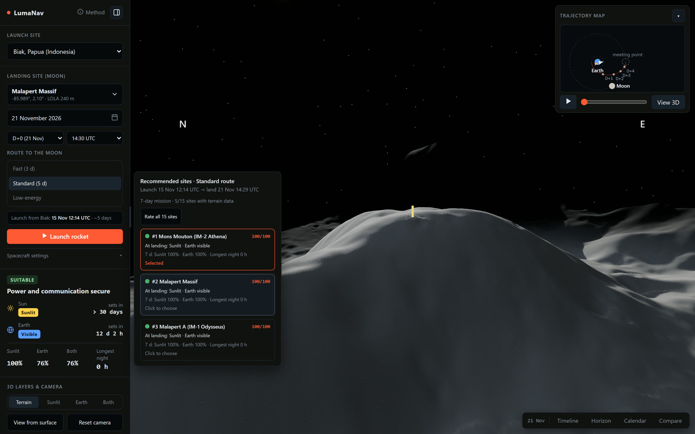

**Site recommendations.** The top three of 15 candidate sites for the chosen route, with the numbers behind each score.

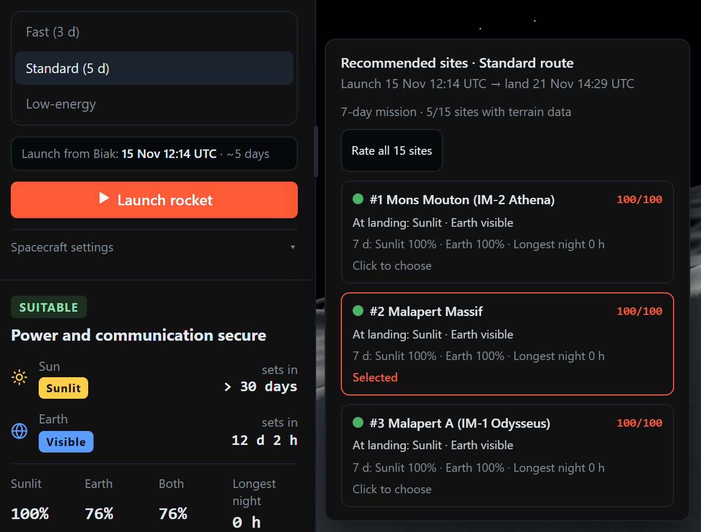

**Visibility status.** Sun and Earth status at the landing moment, how long until each sets, and the longest night.

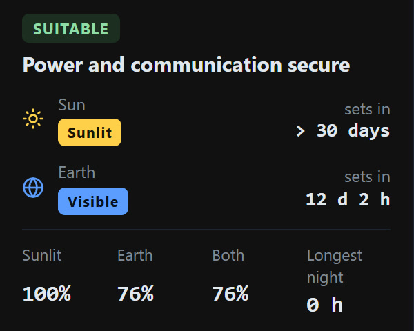

**Terrain horizon.** The real horizon profile with the Sun and Earth paths drawn over it.

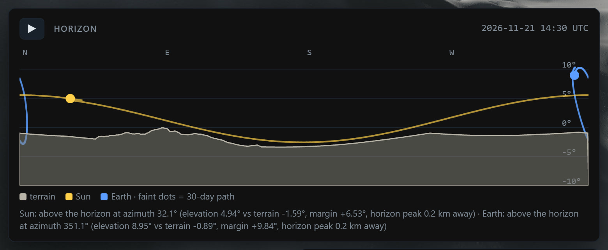

**Landing calendar.** Pick a month by how many good landing days it has, then see the seasonal pattern across the year.

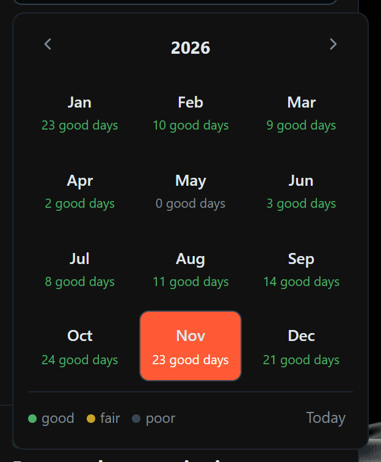

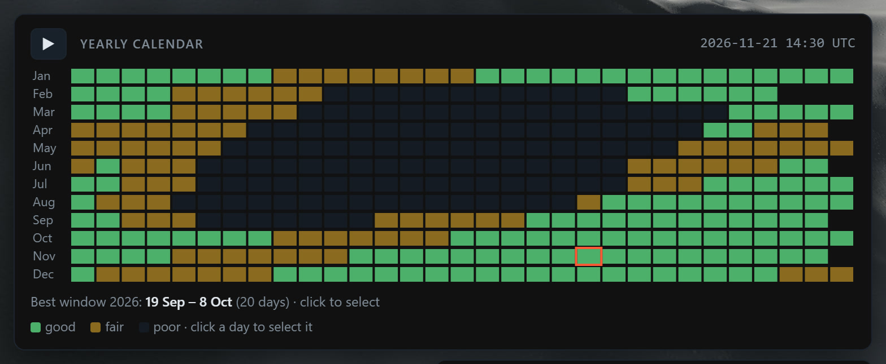

**Scenario comparison.** Sites and launch delays side by side.

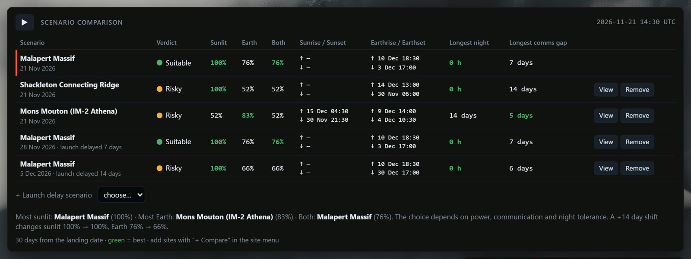

**Illumination map.** In Shackleton crater the floor stays dark (0% sunlit) while the rim is lit.

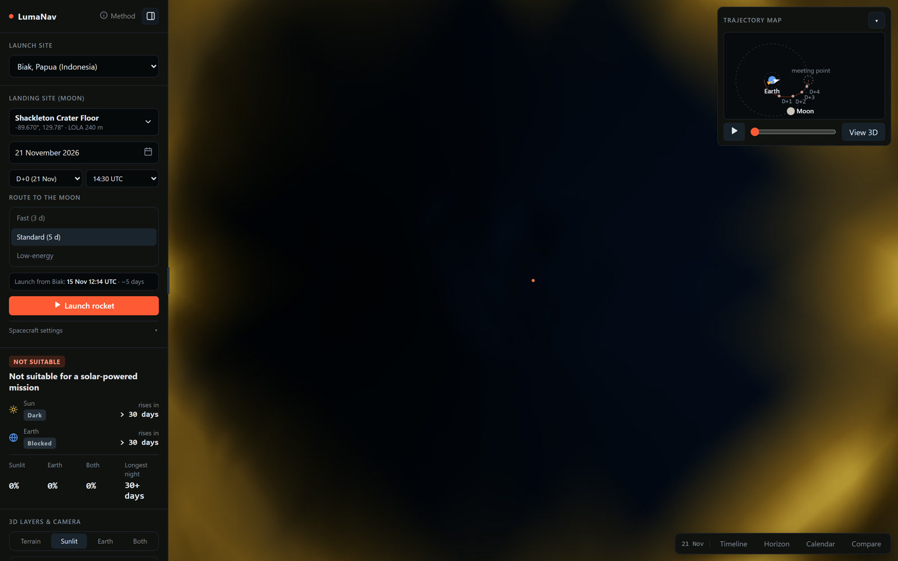

**Flight simulation.**

| | |
| --- | --- |
| 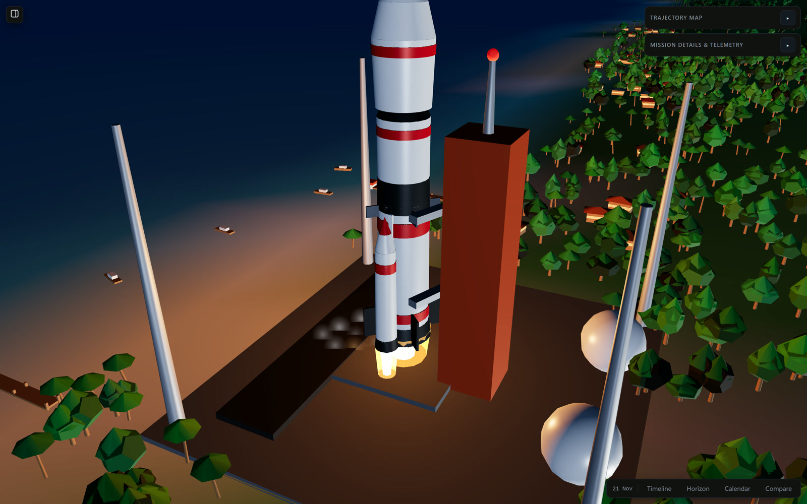 | 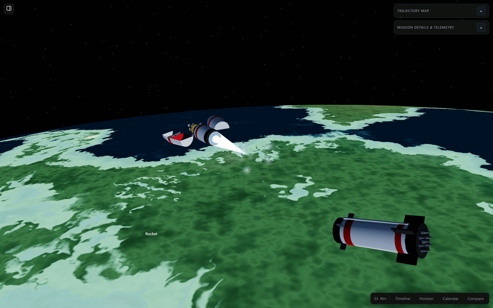 |
| **Liftoff** from the chosen pad | **Ascent** to Earth orbit |
| 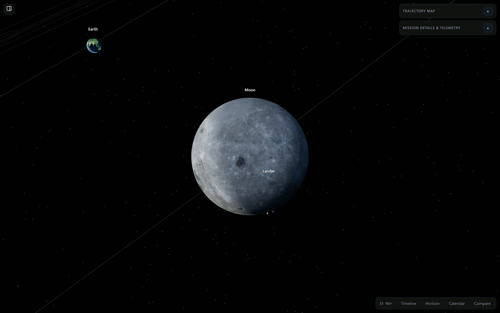 | 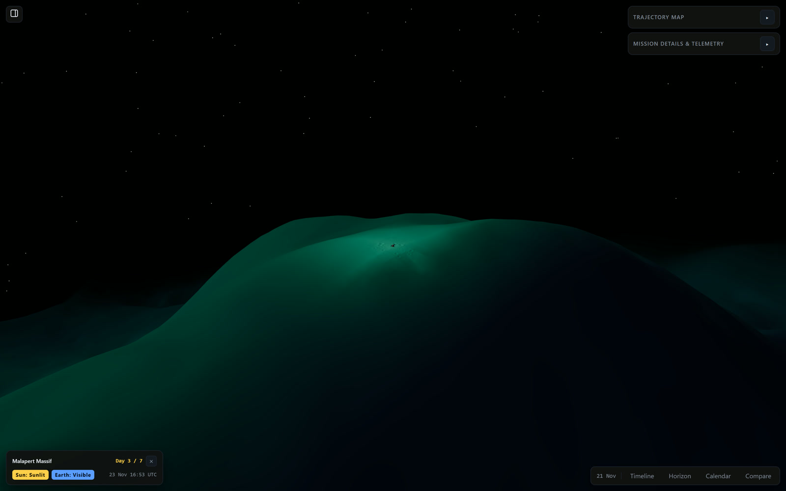 |
| **Lunar orbit** at 100 km | **Surface timelapse**: green = sunlit with Earth in view |

**Validation against NASA JPL Horizons.** Maximum difference 0.0055° over 8 epochs (about 1% of the Sun's apparent width).

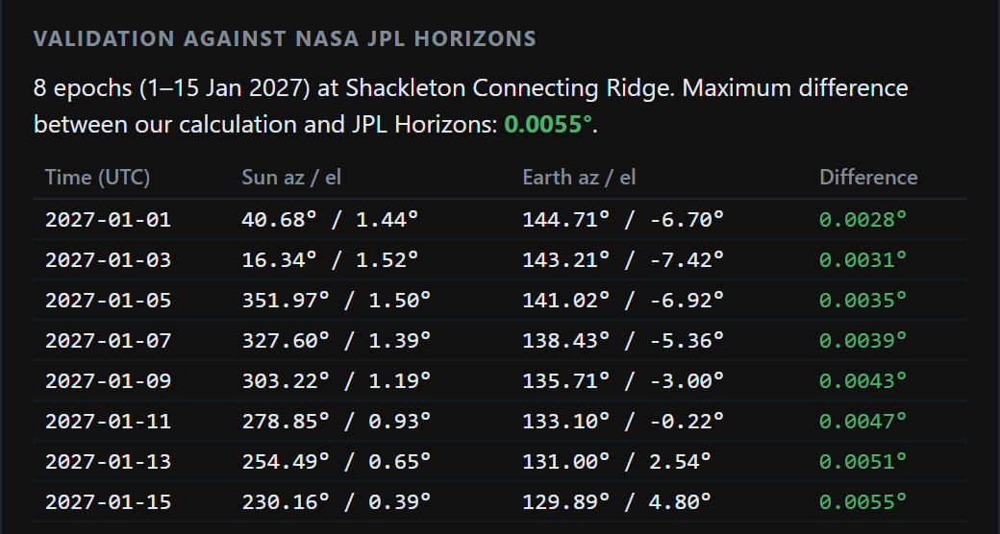

---

## 🏗️ System Architecture & Methodology

LumaNav integrates NASA elevation datasets, astronomical calculations, geometric horizon analysis, and mission physics into a deterministic analysis pipeline.

### 1. Data Integration

The platform combines the following inputs:

- **NASA LRO / LOLA elevation data** for lunar terrain reconstruction.
- **Astronomical positioning calculations** using VSOP87 and the IAU lunar rotation model, including lunar libration.
- **Mission configuration**, including landing date, target time, launch pad, and selected flight route.

### 2. Terrain Horizon Construction

For every candidate landing location, LumaNav reconstructs the surrounding terrain horizon to determine which astronomical objects can be observed from the selected position.

The calculation works as follows:

- Cast terrain rays in 720 directions, covering a complete 360° horizon.
- Calculate the maximum terrain elevation angle for each direction.
- Extend terrain analysis up to 150 km from the landing point.
- Account for the Moon's curvature when calculating horizon obstruction.

This produces a terrain-dependent horizon profile that serves as the reference for subsequent visibility calculations.

### 3. Astronomical Visibility Analysis

The Sun and Earth positions are calculated at 30-minute intervals over a 30-day period.

Using the computed astronomical positions and the terrain horizon:

- **Sunlight availability** is determined by whether the Sun's 0.53° apparent disc is above the local terrain horizon.
- **Earth visibility** is determined by whether Earth's centre is above the local terrain horizon.

The results provide a time-dependent representation of illumination and direct Earth visibility for each candidate landing site.

### 4. Landing Site Scoring

Each candidate location receives a deterministic score between 0 and 100.

The scoring system evaluates five environmental conditions:

| Evaluation Criteria | Weight |
| --- | ---: |
| Sunlight availability at touchdown | +20 |
| Earth visibility at touchdown | +10 |
| Proportion of time with both sunlight and Earth visibility | +35 |
| Proportion of total time with sunlight | +20 |
| Continuous sunlight at the beginning of the surface stay | +15 |
| **Total** | **100** |

Candidate sites are ranked according to their resulting scores.

The analysis prioritizes locations that provide favorable sunlight and Earth visibility conditions during the initial seven days of surface operations.

A candidate whose terrain elevation map has not been loaded cannot receive the highest ranking, helping prevent incomplete terrain data from producing misleading recommendations.

### 5. Mission Trajectory & Launch-Time Calculation

The mission planner uses simplified physical models to estimate the relationship between the selected landing scenario and its launch time.

The calculation incorporates:

- Tsiolkovsky rocket equation for estimating velocity changes across mission phases.
- Typical delta-v values assigned to each mission phase.
- Kepler transfer ellipse for the Earth-to-Moon transfer.
- A 100 km polar lunar orbit.
- Descent calculations toward the selected landing coordinates.
- Earth's rotation when determining the launch pad's position.

The launch-time solver works backward from the desired lunar touchdown time to estimate when the mission should begin.

This provides a consistent mission scenario for exploring different launch windows and landing locations.

---

## 🛰️ Technology Stack

LumaNav is built using a combination of astronomical computation, 3D visualization, and modern web development technologies.

| Technology | Purpose |
| --- | --- |
| **Three.js** | Interactive 3D lunar terrain and mission visualization. |
| **astronomy-engine** | Sun and Earth astronomical positioning and lunar orientation calculations. |
| **Vite** | Development server and production build tooling. |
| **NASA LOLA Data** | Lunar elevation and terrain reconstruction. |
| **NASA JPL Horizons** | Reference astronomical positions for validation. |

---

## 📊 Validation & Testing

LumaNav emphasizes transparent calculations and reproducible results.

### Astronomical Validation

Computed Sun and Earth positions were compared against NASA JPL Horizons reference data at eight different epochs between **January 1 and January 15, 2027**.

The maximum angular difference observed during the comparison was:

**0.0055°**

The comparison can also be recomputed directly in the browser through the platform's **Method** panel.

### Automated Testing

The project's test suite covers several important calculation and simulation components:

| Test Area | Validation |
| --- | --- |
| Astronomical Positions | Comparison against NASA JPL Horizons reference positions. |
| Terrain Orientation | Correct orientation of LOLA elevation maps, including far-side and equatorial cases. |
| Landing Accuracy | Simulated touchdown position remains within 1 km of the target. |
| Mission Physics | Flight speeds remain within physically reasonable ranges. |
| Launch-Time Solver | Calculated launch time reaches the target landing time within one second. |
| Recommendation System | Identical inputs consistently produce identical rankings. |

Run the test suite locally using:

```bash
npm test
```

---

## 🌍 Impact & Potential Applications

LumaNav provides an interactive environment for exploring lunar landing conditions and understanding how local terrain influences mission scenarios.

The platform is designed to support different groups working with lunar exploration concepts.

### 🚀 Mission Planners

- Compare candidate landing locations and landing times.
- Examine environmental conditions before selecting a mission scenario.
- Explore potential launch windows.
- Evaluate sunlight and Earth visibility during initial surface operations.

### 🔬 Lunar Researchers

- Investigate how local topography affects astronomical visibility.
- Study terrain horizon obstruction.
- Examine illumination patterns across different locations and periods.
- Explore relationships between lunar elevation and environmental conditions.

### 🛰️ Rover & Lander Teams

- Explore potential periods of sunlight and direct Earth visibility.
- Consider environmental constraints when evaluating surface-operation scenarios.
- Compare visibility conditions across candidate landing locations.

### 🌌 Space Technology Developers

- Work with lunar elevation and visibility datasets.
- Explore terrain-aware visualization approaches.
- Examine how astronomical positioning can be integrated into interactive mission-planning tools.

LumaNav aims to make lunar environmental conditions more accessible and understandable, helping users develop a clearer picture of potential landing environments before proceeding with further mission studies.

---

## 🛰️ Data Sources & Credits

LumaNav uses publicly available NASA datasets and open-source libraries.

### NASA Data Sources

- **NASA Lunar Reconnaissance Orbiter (LRO) / Lunar Orbiter Laser Altimeter (LOLA)**  
  Gridded lunar elevation datasets obtained from the PDS Geosciences Node:
  - `LDEM_75S_240M`
  - `LDEM_75N_240M`
  - `LDEM_16`

- **NASA JPL Horizons**  
  Reference astronomical positions used for validating the computed Sun and Earth positions.

- **NASA Scientific Visualization Studio – CGI Moon Kit**  
  LRO / LROC color mosaic used for the lunar surface texture (`public/textures/moon.jpg`).

- **NASA GIBS Blue Marble Next Generation**  
  Earth imagery used in the platform's visualization assets.

- **NASA Earth Observatory – Black Marble 2016**  
  Earth night-light imagery used in the visualization assets.

### Open-Source Libraries

- [astronomy-engine](https://github.com/cosinekitty/astronomy) — MIT License.
- [Three.js](https://threejs.org/) — MIT License.
- [Vite](https://vitejs.dev/) — MIT License.

The open-source [Artemis II Tracker by Javilop](https://github.com/Javilop/Artemis-II-Tracker) was referenced for inspiration only. No code or assets from that project are used in LumaNav.

---

## 💻 Getting Started

### Live Demo

Explore LumaNav directly through the deployed application:

**[https://lumanav-eta.vercel.app](https://lumanav-eta.vercel.app)**

### Local Development

Follow these steps to run LumaNav on your local machine.

**Prerequisites**

- Node.js
- npm

**Installation**

```bash
# Install project dependencies
npm install
```

**Start Development Server**

```bash
npm run dev
```

The application will be available at:

```text
http://localhost:5173
```

**Run Tests**

```bash
npm test
```

**Production Build**

```bash
npm run build
```

The production-ready static application will be generated in the `dist/` directory.

The build uses a relative base path (`./`), allowing the generated output to be deployed to different static hosting environments.

---

## ⚠️ Limitations & Scope

LumaNav is designed as a lunar landing site exploration and early mission-planning support tool. Its results should be interpreted within the scope of the underlying datasets and simplified calculations.

- **Environmental Visibility:** The platform evaluates sunlight availability and geometric line of sight to Earth. It does not guarantee actual radio communication quality, landing safety, or mission success.

- **Terrain Resolution:** Polar elevation data provides approximately 240 m per pixel at latitudes of 75.2° and beyond. Other regions use approximately 1.9 km per pixel, meaning smaller hills, ridges, and craters may not be represented accurately.

- **Illumination Map:** The illumination map uses a coarser spatial grid to improve performance. Its values should therefore be treated as approximate.

- **Mission Trajectory:** Flight simulations use typical delta-v estimates and simplified transfer mechanics. They are intended for visualization and early planning rather than high-fidelity trajectory optimization.

- **Low-Energy Route:** The low-energy transfer path is presented for illustrative purposes and should not be interpreted as an optimized operational trajectory.

- **Landing Coordinates:** Coordinates associated with some commercial lunar landers are approximate.

LumaNav provides information to support scenario exploration and comparison. **The final landing-site selection remains the user's responsibility, and no recommendation guarantees mission success.**

---

## 👥 Team

**Team Flashover**

| Team Member |
| --- |
| M. Davin Surya |
| Halim Bagus Al Hakim |
| Yudha Putra Ramadhan |
| Lu'lu' Luthfiah |

Built with dedication for the **NASA Space Apps Challenge 2026 – Lunar Landing Site Navigator**.

---

<div align="center">

### 🌙 LumaNav

**Discover Lunar Landing Windows Through Terrain-Aware Analysis.**

*Bringing lunar terrain, astronomical visibility, and mission simulation together.*

**Built by Team Flashover for NASA Space Apps Challenge 2026.**

</div>
